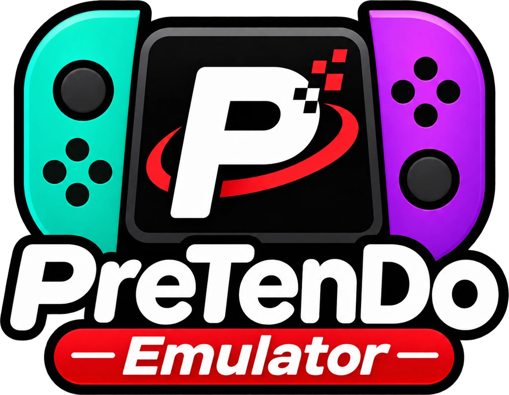

<!--
# SPDX-FileCopyrightText: Copyright 2026 PreTenDo Emulator contributors
# SPDX-License-Identifier: GPL-3.0-or-later
-->

  

<h4 align="center">A free, open-source Switch 2 emulator for Windows</h4>

  
  
  
  

  <a href="#download">Download</a> &nbsp;&bull;&nbsp;
  <a href="#features">Features</a> &nbsp;&bull;&nbsp;
  <a href="#playing">Playing</a> &nbsp;&bull;&nbsp;
  <a href="#building">Building</a> &nbsp;&bull;&nbsp;
  <a href="#license">License</a>

## Download

Get the latest build from [Releases](https://github.com/pretend7979/pretendo-emulator/releases):
unzip `PreTenDo-Emulator-<version>-windows-x64.zip` anywhere and run `pretendo.exe`. It checks
these releases for updates itself.

Want all your consoles in one place? [Pretendulator](https://github.com/pretend7979/pretendulator)
is a game library that downloads PreTenDo Emulator for you and starts your Switch 2 games in it.

## Features

- **Switch 2 games** from `.nup` dumps of your own cartridges and downloads.
- **Per-game settings**: graphics, CPU and controls can differ for each game.
- **Updates itself** from this repository's releases.
- **Works with [Pretendulator](https://github.com/pretend7979/pretendulator)**, which can download,
  update and launch it, and open a game's settings directly.

## Playing

PreTenDo Emulator plays games from your own console. It ships no games, keys or firmware: dump
them from hardware you own.

Switch 2 games come as `.nup` files. Per-game settings are under a game's Properties; a frontend
can open them directly with `pretendo.exe --game-settings "<game file>"`.

## Building

See the [build guide](docs/Build.md). Release builds are made with
`dist/packaging/release_pretendo.py`, which builds, packages and publishes a version.

## Contributing

See [CONTRIBUTING.md](CONTRIBUTING.md) and the [AI policy](docs/policies/AI.md).

## License

PreTenDo Emulator is licensed under the GPLv3 (or any later version); see
[LICENSE.txt](LICENSE.txt). It is based on the Eden emulator, which grew out of yuzu; their
copyright notices are kept in the source files.

"Nintendo Switch" is a trademark of Nintendo. PreTenDo Emulator is not affiliated with Nintendo.
